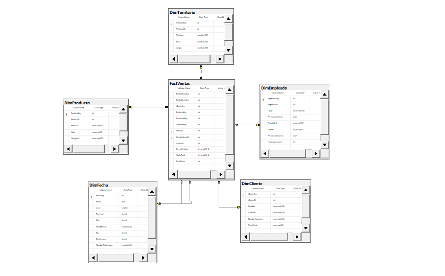

# Certamen 2 - Inteligencia de Negocios

Universidad Técnica Federico Santa María · Año académico 2026

## Caso seleccionado

**Caso 2: Bike Z**, empresa que vende artículos para motocross.

## Integrantes y sección

| Integrante | Paralelo | Profesor |
|---|---|---|
| Jairo Duzan Palomino Lozada (GitHub: Duzaan) | 301 | Hernan Saavedra Gonzales |

El proyecto se desarrolla de forma individual.

## Descripción del problema

Bike Z ha crecido rápidamente en los últimos años y su propietario decidió incorporar Inteligencia de Negocios para apoyar la toma de decisiones. La base de datos transaccional contiene la ubicación de los almacenes, los clientes, los empleados, el detalle de las ventas y los productos.

Volumen de datos analizado:

| Elemento | Cantidad |
|---|---|
| Ventas | 31.465 |
| Líneas de detalle de venta | 121.317 |
| Clientes | 19.820 |
| Productos | 504 |
| Empleados | 290 |
| Territorios | 10 |
| Período de ventas | 2015-07-01 a 2018-07-31 |

## Objetivo del proyecto

Diseñar e implementar una solución de Inteligencia de Negocios para Bike Z: modelo dimensional y proceso ETL (Fase 1), y cubo OLAP y dashboard en Power BI (Fase 2), alineados con los KPI definidos.

## KPI definidos

| N.º | KPI | Cálculo | Utilidad para la toma de decisiones |
|---|---|---|---|
| 1 | Ventas totales | Σ (Cantidad × PrecioUnitario) | Mide el desempeño global del negocio y su evolución. |
| 2 | Unidades vendidas por producto y categoría | Σ Cantidad | Identifica productos y categorías de mayor rotación. |
| 3 | Ticket promedio | Ventas totales ÷ N.º de ventas | Evalúa el valor medio de cada transacción. |
| 4 | Crecimiento de ventas (mensual y anual) | (Período − Período anterior) ÷ Período anterior | Detecta tendencias y estacionalidad. |
| 5 | Ventas por vendedor | Σ ventas por empleado | Evalúa el desempeño comercial. |
| 6 | Ventas por cliente | Σ ventas por cliente | Identifica clientes clave y concentración de ingresos. |
| 7 | Participación por territorio y país | Ventas del territorio ÷ Ventas totales | Orienta la inversión hacia las zonas de mayor rendimiento. |
| 8 | Tiempo promedio de envío | Promedio de (FechaEnvio − Fecha), en días | Mide la eficiencia logística. |

Observaciones derivadas del análisis de calidad de datos:
- **KPI 5:** el 87,9 % de las ventas (27.658) no tiene vendedor asignado, aunque concentra el 26,6 % del ingreso. Las ventas con vendedor (3.807) concentran el 73,4 %. El KPI se presenta siempre con la categoría "Sin vendedor".
- **KPI 6:** los clientes sin nombre (9.546 de 19.820) concentran el 82,2 % del ingreso, por lo que se analizan como un grupo propio y no se descartan.

## Modelo dimensional

Esquema en estrella, construido con la metodología de Kimball (ver `docs/modelo-dimensional/kimball.md`).



### Proceso de negocio

Ventas de artículos de motocross.

### Granularidad

Una fila por línea de detalle de venta (`VentaID` + `DetalleVentaID`). Cardinalidad esperada: 121.317 filas.

### Dimensiones

| Dimensión | Origen | Atributos principales |
|---|---|---|
| `DimFecha` | Generada por script (2015-01-01 a 2018-12-31) | Fecha, año, trimestre, mes, nombre del mes, día, día de la semana |
| `DimCliente` | `Clientes` | ClienteID, Nombre, Apellido, NombreCompleto, TipoCliente |
| `DimProducto` | `Productos` + `Categorias` | ProductoID, Producto, Color, Categoría |
| `DimEmpleado` | `Empleados` (vendedor) | EmpleadoID, Cargo, FechaNacimiento, EstadoCivil, Género, FechaContratación, HorasVacaciones |
| `DimTerritorio` | `Territorios` + `Paises` | TerritorioID, Territorio, País, Grupo |

Decisiones de diseño:
- `DimFecha` tiene doble rol: fecha de venta y fecha de envío.
- Claves sustitutas en todas las dimensiones, conservando la clave de negocio.
- Registro "Desconocido" (clave −1) en cada dimensión. Las ventas sin vendedor se asocian a "Sin vendedor".
- La tabla `Almacenes` queda fuera del modelo: se relaciona solo con `Territorios`, no con las ventas.

### Tabla de hechos y medidas

`FactVentas`: claves de las seis relaciones, `VentaID` y `DetalleVentaID` como dimensión degenerada, y las medidas `Cantidad` (aditiva), `PrecioUnitario` (no aditiva), `VentaTotal` = Cantidad × PrecioUnitario (aditiva) y `DiasEnvio` (no aditiva).

## Proceso ETL - Fase 1

Proyecto de Visual Studio `etl/proyecto-ssis/BikeZ_ETL` (SSIS), que carga `BikeZ_DW` desde la base transaccional `BikeZ`.

| Paquete | Función |
|---|---|
| `Load_DimProducto` | Une productos con categorías (LEFT JOIN) y reemplaza color y categoría nulos |
| `Load_DimTerritorio` | Une territorios con países y reemplaza nulos |
| `Load_DimEmpleado` | Carga empleados y convierte las fechas al tipo DATE |
| `Load_DimCliente` | Genera nombre completo y tipo de cliente para los clientes sin nombre |
| `Load_FactVentas` | Une ventas y detalle, busca claves sustitutas (Lookup) y calcula `VentaTotal` y `DiasEnvio` |
| `Master_BikeZ_ETL` | Orquesta la ejecución completa en el orden correcto |

Transformaciones y calidad de datos: columnas derivadas, `TRIM` y `ISNULL`, búsquedas con asignación de clave −1, carga repetible (limpieza previa y reinicio de claves).

### Validación de la carga

| Control | Origen | Destino |
|---|---|---|
| Productos / `DimProducto` | 504 | 504 |
| Territorios / `DimTerritorio` | 10 | 10 |
| Empleados / `DimEmpleado` | 290 | 290 |
| Clientes / `DimCliente` | 19.820 | 19.820 |
| Líneas de detalle / `FactVentas` | 121.317 | 121.317 |
| Ingreso total | 110.373.889,3134 | 110.373.889,3134 |

Consultas en `database/scripts/validacion_etl.sql`; capturas en `docs/evidencias/`.

## Cubo OLAP - Fase 2

Pendiente (Fase 2).

## Dashboard Power BI - Fase 2

Pendiente (Fase 2).

## Avances por fase

| Fase | Componente | Estado |
|---|---|---|
| Fase 1 | Análisis del caso, perfilamiento de datos y definición de KPI | Completado |
| Fase 1 | Cuatro pasos de Kimball y diseño del modelo dimensional | Completado |
| Fase 1 | Implementación del modelo en SQL Server (`BikeZ_DW`) | Completado |
| Fase 1 | Proceso ETL en SSIS y validación de la carga | Completado (ver sección ETL) |
| Fase 1 | Backup de la base dimensional con datos cargados | Completado |
| Fase 2 | Cubo OLAP (SSAS) | Pendiente |
| Fase 2 | Dashboard en Power BI | Pendiente |

## Tecnologías utilizadas

| Tecnología | Uso |
|---|---|
| SQL Server 2019 | Base transaccional (`BikeZ`) y base dimensional (`BikeZ_DW`) |
| SQL Server Management Studio | Scripts, validaciones y respaldos |
| Visual Studio 2019 + SSIS Projects | Proceso ETL |
| Git y GitHub | Control de versiones y trazabilidad |

## Estructura del repositorio

```
Certamen2-BI/
|-- README.md
|-- docs/
|   |-- kpi.md
|   |-- evidencias/             capturas de perfilamiento, carga y validación
|   |-- modelo-dimensional/     kimball.md y diagrama del modelo
|   `-- presentacion/           presentación de la Fase 1
|-- database/
|   |-- scripts/                perfilamiento, creación del modelo, diccionario de datos, validación
|   `-- backup/                 BikeZ_DW.bak (datos cargados)
`-- etl/
    `-- proyecto-ssis/          proyecto BikeZ_ETL
```

Las carpetas `olap` y `powerbi` corresponden a la Fase 2.

## Instrucciones de ejecución/revisión

**Opción A: revisar el resultado**
1. Restaurar `database/backup/BikeZ_DW.bak` en SQL Server 2019.
2. Ejecutar las consultas de `database/scripts/validacion_etl.sql`.

**Opción B: reproducir el proceso**
1. Restaurar la base de origen `BikeZ.bak`.
2. Ejecutar `database/scripts/crear_modelo_dimensional.sql`.
3. Abrir `etl/proyecto-ssis/BikeZ_ETL/BikeZ_ETL.sln` en Visual Studio 2019 (con la extensión SQL Server Integration Services Projects).
4. En los administradores de conexión, cambiar el servidor `DESKTOP-LV7URAU` por el del equipo. Usan autenticación de Windows.
5. Ejecutar `Master_BikeZ_ETL.dtsx` y luego `validacion_etl.sql`.

## Distribución de responsabilidades y aportes

Proyecto individual. Todas las tareas fueron realizadas por el integrante: análisis y KPI, perfilamiento, diseño con Kimball, implementación en SQL Server, ETL en SSIS, validación, documentación y presentación. El historial de commits, ramas y Pull Requests del repositorio registra el avance.